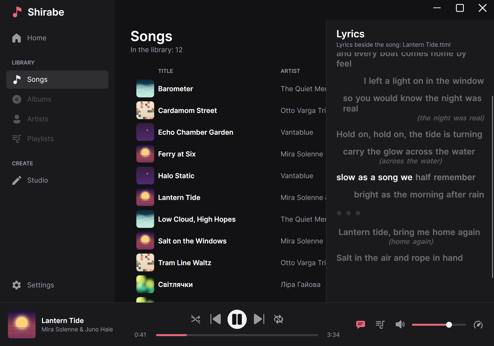
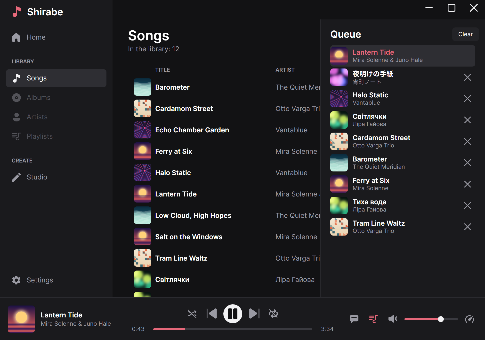
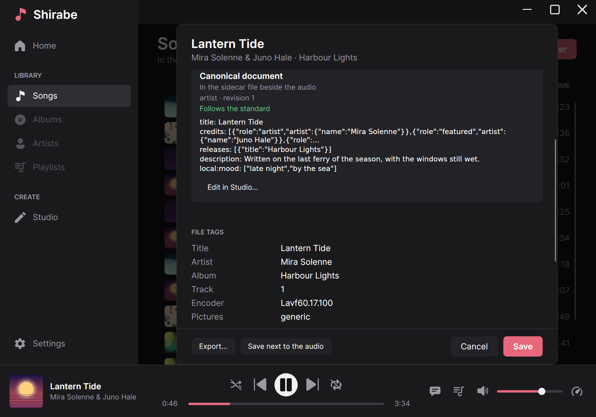
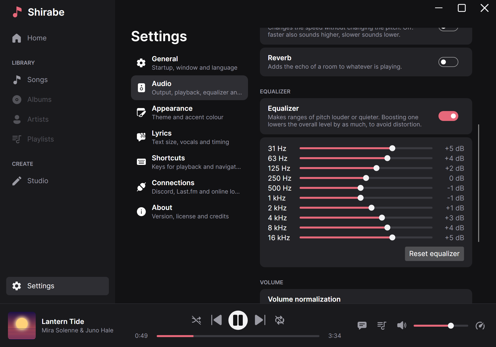

# Shirabe (シラベ)

A music player for the music you already have, built around one idea: **music deserves more than a play button.**

Most players show you a title, an artist and a cover. Shirabe wants to know more about a song than that — who played
what, what the words are, what the artist wanted to say — and show it while you listen, without getting in the way.
It works fully offline on your own files. No account, no server.

> Shirabe is early and changing quickly. It works and I use it, but expect rough edges.
> It runs on Windows, Linux and macOS; Windows gets the most testing.



| Queue | Song details | Equalizer |
|---|---|---|
|  |  |  |

<sub>The music, artists and artwork in the screenshots are made up.</sub>

## What it does today

- **Plays your music.** Add a folder, Shirabe scans it and keeps a library. Queue, shuffle, repeat, volume, keyboard
  shortcuts you can change, and it remembers where you left off.
- **Lyrics.** Open the lyrics panel and follow along. Synced lyrics highlight the current line and fill word by word,
  like karaoke. It reads `.lrc` and `.ttml` files (including the ones
  [Better Lyrics](https://composer.betterlyrics.org/) makes), or lyrics already inside the file's tags. Duets,
  background vocals and breaks between lines are shown too. Click a line to jump to it.
- **Sound.** Output device, playback speed (slowed or sped up, with or without changing the pitch), reverb, a 10-band
  equalizer and ReplayGain volume normalization.
- **Song details.** Right-click a song and choose Properties: the tags in the file, and your own custom fields.
- **Studio.** A place to write and check richer song information in the *Shirabe Metadata Format* (a small open JSON
  format, drafted in this project). Save it as a file next to the song, or into the song's own tags when you ask for it.
- **Looks and language.** Themes (you can add your own), an accent colour that follows the cover, a reduce-motion
  switch, and a partly translated interface.
- **Connections, all optional.** Discord status, Last.fm scrobbling, covers looked up online or linked from a song's
  metadata, and a check for new versions.

Not there yet: albums, artists and playlists pages, and a backend.

The [wiki](https://github.com/zimavi/Shirabe.Client/wiki) explains each of these.

## Install

Download from [Releases](https://github.com/zimavi/Shirabe.Client/releases). Some of what is described here may be newer
than the latest release.

| System                | File                                                                              |
|-----------------------|-----------------------------------------------------------------------------------|
| Windows (x64)         | `Shirabe-win-Setup.exe` or `Shirabe-win.msi`                                      |
| Linux (x64)           | `Shirabe.AppImage` (make it executable, then run it), `.deb`, `.rpm` or `.tar.gz` |
| macOS (Apple silicon) | `Shirabe-osx-arm64.dmg` (drag Shirabe into Applications)                          |

Nothing is signed with a paid certificate, so your system may warn you.

**macOS, first launch:** macOS blocks the app because Apple cannot verify it. Try to open it once, then go to **System
Settings → Privacy & Security** and press **Open Anyway**. If macOS calls the app *damaged* instead (releases up to
0.2.0-beta.2 may), run `xattr -dr com.apple.quarantine /Applications/Shirabe.app` in Terminal, only for a copy you
downloaded from the page above.

## Known issues

- **macOS:** with **Playback speed control** on and **Keep pitch** off, lyrics were out of sync with the song almost all
  the time (seen on one Mac, cause not yet found). Turn Keep pitch on, or turn speed control off.
- **Windows, 0.1.0 to 0.2.0-beta.2:** these versions keep your library in the folder the app is installed in
  (`%LOCALAPPDATA%\Shirabe`). **Installing a newer version over them, or uninstalling them, can delete the library and
  settings**: quit Shirabe (from its tray icon) and copy that folder somewhere else first. After installing the new
  version, quit it too, delete any `library.db*` files in `%LOCALAPPDATA%\ShirabeData`, then copy `library.db*`,
  `settings.json`, `session.json`, `artwork` and `themes` from your copy into that folder.
- **Linux:** some desktops have no system tray. "Keep running in the tray" is therefore off by default there. Also, FLAC
  doesn't play here.

## Build from source

You need the [.NET 10 SDK](https://dotnet.microsoft.com/download).

```
dotnet run --project Shirabe.Client.Desktop
```

The first build downloads the audio libraries (BASS and BASS_FX) for your platform from their website, so it needs a
connection once. If that fails, see [native/README.md](native/README.md).

Last.fm needs an API key and is left out of builds without one. To have it, copy `build/Secrets.local.props.example`
to `build/Secrets.local.props` (git-ignored) and fill in your own
[key and shared secret](https://www.last.fm/api/account/create).

Run the tests with:

```
dotnet test
```

## Lyrics: how to add them

Put a file with the **same name as the song** next to it:

```
Music/
  Some Song.flac
  Some Song.ttml      <- or Some Song.lrc
```

or put lyrics in the song's tags. Timed lyrics win over plain text, and a `.ttml` file wins over `.lrc`.
You can tune the text size, background vocals, break markers and timing in **Settings → Lyrics**.

## Your data

- Your library and settings live in one folder (the library is `library.db`, a normal SQLite file):
  `%LOCALAPPDATA%\ShirabeData` on Windows, `~/.local/share/Shirabe` on Linux, `~/Library/Application Support/Shirabe`
  on macOS. Uninstalling on Windows leaves it there; delete it yourself if you want it gone. (Up to the 0.2.0 betas,
  Windows used `%LOCALAPPDATA%\Shirabe`; the data is moved on the first start of a newer version.)
- Shirabe does not change your audio files, with one exception: if you choose **Write into the audio file** in Studio,
  it adds one tag (`SHIRABE_METADATA`) after asking you, keeps a copy while it works, and puts the original back if
  anything looks wrong.
- Your own notes and fields are never overwritten by a rescan or by anything that comes from outside.
- A Last.fm sign-in is kept in the system's secure storage (Windows Credential Manager, or the Secret Service on Linux),
  never in a file. On macOS it is not saved yet, so you sign in again after each start.

## How it is put together

| Folder                   | What is in it                                                                     |
|--------------------------|-----------------------------------------------------------------------------------|
| `Shirabe.Client`         | The app's screens and view models (Avalonia)                                      |
| `Shirabe.Client.Desktop` | The desktop program that starts it, and self-update                               |
| `Shirabe.Core`           | The small interfaces everything else shares (playback, library, lyrics, metadata) |
| `Shirabe.Audio`          | Playback, using BASS                                                              |
| `Shirabe.Library`        | The local library: SQLite, scanning, reading tags                                 |
| `Shirabe.Metadata`       | The metadata format: reading, checking and writing documents                      |
| `Shirabe.Tests`          | Tests                                                                             |
| `packaging`              | Icons and installer files                                                         |

`CLAUDE.md` has the longer story of where the project is meant to go.

## Licence

Shirabe is under the [Apache License 2.0](LICENSE.txt).

The audio engine, [BASS](https://www.un4seen.com/), is **not** part of that licence and is not stored in this
repository. It is free for non-commercial use and needs a licence from its authors otherwise — see
[NOTICE.txt](NOTICE.txt) and [native/README.md](native/README.md). The BASS_FX add-on (by JOBnik!) contains SoundTouch
(LGPL) and Freeverb.

Built with [Avalonia](https://avaloniaui.net/), [ManagedBass](https://github.com/ManagedBass/ManagedBass),
[ATL](https://github.com/Zeugma440/atldotnet), [Entity Framework Core](https://learn.microsoft.com/ef/core/) and
[Velopack](https://velopack.io/).
